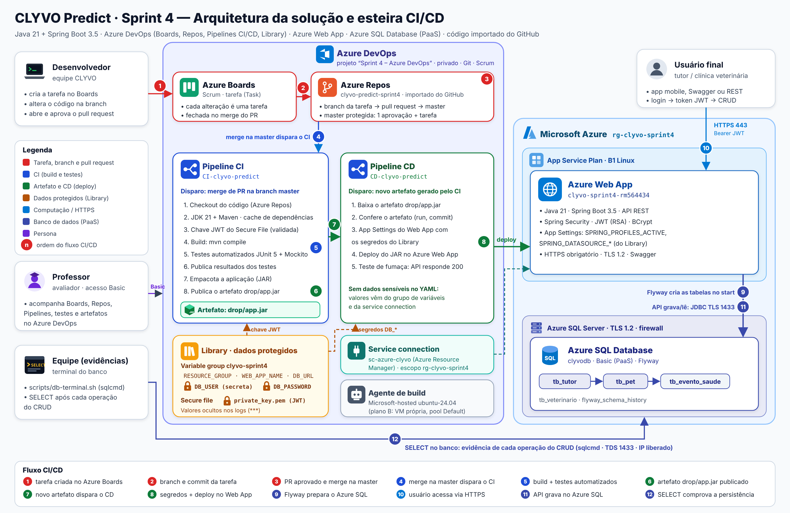

# CLYVO Predict · Sprint 4 — Azure DevOps (CI/CD)

**Disciplina:** DevOps Tools & Cloud Computing · FIAP 2026 · Prof. João Menk

| Entrega | Link |
|---|---|
| Repositório GitHub | https://github.com/eduardawv/clyvo-predict-sprint4 |
| Projeto no Azure DevOps | [https://dev.azure.com/2TDSPX-EDUARDA/Sprint%204%20%E2%80%93%20Azure%20DevOps](https://dev.azure.com/2TDSPX-EDUARDA/Sprint%204%20%E2%80%93%20Azure%20DevOps) |
| Vídeo (YouTube) | https://www.youtube.com/watch?v=INSERIR_LINK |

| Nome completo | RM | Turma |
|---|---|---|
| Camily Vitoria Pereira Maciel | RM566520 | 2TDSPX |
| Eduarda Weiss Ventura | RM564434 | 2TDSPX |
| Lucas Nunes Soares | RM566503 | 2TDSPX |
| Maria Gabriela Landim Severo | RM565146 | 2TDSR |
| Samara Porto Souza | RM559072 | 2TDSR |

---

## 1. Descrição da solução

O **CLYVO Predict** é a API da nossa solução de saúde preventiva para pets, desenvolvida no Challenge FIAP 2026 com a healthtech veterinária Clyvo. A API centraliza **tutores**, **pets**, **veterinários** e **eventos de saúde** (vacinas, consultas, doenças) e calcula para cada pet um **Health Score** de 0 a 100, que sobe com cuidados preventivos e cai com doenças e acidentes. O objetivo é tirar a jornada do pet do modo reativo, só emergência, e dar à clínica um histórico contínuo do paciente.

Nesta sprint, o código Java da Sprint 4 passa a ser entregue por uma esteira **CI/CD no Azure DevOps**:
1. Cada alteração na branch `master` dispara o build, os testes automatizados e a publicação do artefato.
2. Cada novo artefato dispara o deploy no **Azure Web App**, com o banco **Azure SQL Database (PaaS)**.

### Stack

| Camada | Tecnologia |
|---|---|
| Linguagem e framework | Java 21, Spring Boot 3.5 (Web, Data JPA, Validation, Security, OAuth2 Resource Server) |
| Segurança | JWT assinado com RSA, senhas com BCrypt |
| Documentação da API | SpringDoc OpenAPI (Swagger UI) |
| Banco de dados | Azure SQL Database (PaaS), driver `mssql-jdbc`, migrations com Flyway |
| Build e testes | Maven, JUnit 5, Mockito, Hibernate Validator |
| Código-fonte | GitHub (branch `master`) |
| CI/CD | Azure DevOps: Azure Pipelines (YAML) e Library (grupo de variáveis e secure file) |
| Hospedagem | Azure App Service: Web App Linux, Java SE 21, plano B1 |
| Infraestrutura | Azure CLI (scripts na pasta `scripts/`) |

## 2. Arquitetura e fluxo CI/CD



| # | Etapa | Onde acontece |
|---|---|---|
| 1 | O desenvolvedor faz commit e push na branch `master` | IDE + Git → GitHub |
| 2 | O webhook do GitHub dispara a pipeline **CI** | GitHub → Azure Pipelines |
| 3 | Build com Maven e JDK 21; a chave JWT vem do Secure File | Pipeline CI |
| 4 | Testes automatizados (JUnit 5 + Mockito), com resultados publicados na aba *Tests* | Pipeline CI |
| 5 | Publicação do artefato `drop/app.jar` no Azure DevOps | Pipeline CI |
| 6 | O novo artefato dispara a pipeline **CD** | Azure Pipelines |
| 7 | O CD grava as variáveis de ambiente do Web App com os segredos do Library | Pipeline CD → Azure (service connection) |
| 8 | Deploy do JAR no Azure Web App e teste de fumaça (API responde 200) | Pipeline CD → Web App |
| 9 | Na subida da aplicação, o Flyway cria ou atualiza as tabelas | Web App → Azure SQL |
| 10 | O usuário final acessa a API por HTTPS, com token JWT | Usuário → Web App |
| 11 | A API grava e lê no Azure SQL (JDBC criptografado, porta 1433) | Web App → Azure SQL |
| 12 | A equipe comprova cada operação com SELECT no banco | Terminal (sqlcmd) → Azure SQL |

**Personas:**
- **Desenvolvedor:** altera o código e faz push.
- **Usuário final:** tutor ou clínica que usa a API.
- **Professor:** acompanha o projeto com acesso *Basic*.
- **Equipe:** comprova a persistência no banco.

## 3. Banco de dados em nuvem

O banco é o **Azure SQL Database** (PaaS, tier Basic), no servidor `clyvo-sprint4-sql-rm564434`.

O Flyway cria as tabelas automaticamente na primeira subida da aplicação, a partir de `src/main/resources/db/migration/sqlserver/V1__cria_tabelas.sql`. A mesma DDL está em [`scripts/ddl-azure-sql.sql`](scripts/ddl-azure-sql.sql).

| Tabela | Conteúdo | Relacionamento |
|---|---|---|
| `tb_tutor` | Tutores (e-mail único, senha BCrypt, perfil) | 1:N com `tb_pet` |
| `tb_pet` | Pets (espécie, raça, idade, peso, health score) | FK `tutor_id` → `tb_tutor` |
| `tb_evento_saude` | Vacinas, consultas, doenças | FK `pet_id` → `tb_pet` |
| `tb_veterinario` | Veterinários (CRMV único) | — |

O firewall do SQL libera apenas os serviços do Azure (o Web App) e o IPv4 da equipe. A conexão exige TLS 1.2.

## 4. Projeto no Azure DevOps

| Campo | Valor |
|---|---|
| Project name | `Sprint 4 – Azure DevOps` |
| Description | Projeto para entrega da Sprint 4 do professor João Menk (texto completo abaixo) |
| Visibility | Private |
| Version control | Git |
| Work item process | Scrum |

Descrição cadastrada no projeto:

```
Projeto para entrega da Sprint 4 do professor João Menk
RM564434 - Eduarda Weiss Ventura - 2TDSPX
RM566520 - Camily Vitoria Pereira Maciel - 2TDSPX
RM566503 - Lucas Nunes Soares - 2TDSPX
RM565146 - Maria Gabriela Landim Severo - 2TDSPX
RM559072 - Samara Porto Souza - 2TDSPX
```

## 5. Acesso do professor

O professor foi convidado em *Organization settings > Users*, com nível de acesso **Basic** e adicionado ao projeto `Sprint 4 – Azure DevOps`.

A organização gratuita permite **5 usuários Basic**: o professor ocupa um deles, e os demais integrantes podem entrar como *Stakeholder*.

## 6. Pipelines CI/CD (YAML)

| Pipeline | Arquivo | Disparo |
|---|---|---|
| `CI-clyvo-predict` | [`azure-pipelines-ci.yml`](azure-pipelines-ci.yml) | toda alteração na branch `master` |
| `CD-clyvo-predict` | [`azure-pipelines-cd.yml`](azure-pipelines-cd.yml) | conclusão do CI com novo artefato (`resources.pipelines`) |

### 6.1 CI: build, testes e artefato

| Passo | O que faz |
|---|---|
| 1. Checkout | Baixa o código do GitHub (branch `master`) |
| 2. JDK 21 e Maven | Seleciona o JDK 21 do agente e mostra as versões |
| 3. Cache Maven | Reaproveita as dependências entre execuções |
| 4. Secure File | Baixa `private_key.pem` (chave privada do JWT) do Library |
| 5. Validação da chave | Confere se a chave privada corresponde à `public_key.pem` do repositório |
| 6. Build | `mvn clean compile` |
| 7. Testes automatizados | `mvn test` (JUnit 5 + Mockito) |
| 8. Resultados dos testes | Publica os relatórios JUnit na aba *Tests* da execução |
| 9. Empacotamento | `mvn package` e cópia para `app.jar` |
| 10. Artefato | Publica `drop/app.jar` no Azure DevOps (aba *Artifacts / published*) |

### 6.2 CD: deploy automático

| Passo | O que faz |
|---|---|
| 1. Artefato | Baixa `drop/app.jar` gerado pela execução do CI que disparou o CD |
| 2. Conferência | Mostra a execução, a branch e o commit de origem |
| 3. Variáveis de ambiente | `AzureAppServiceSettings@1` grava `SPRING_PROFILES_ACTIVE` e `SPRING_DATASOURCE_*` no Web App, a partir do grupo de variáveis protegido |
| 4. Deploy | `AzureWebApp@1` publica o JAR no Web App Linux (Java SE 21) |
| 5. Teste de fumaça | Aguarda a API responder HTTP 200 em `/v3/api-docs` e mostra o título e a versão publicados |

### 6.3 Variáveis protegidas

Nenhum usuário, senha ou chave fica no código ou no YAML.

| Onde | Nome | Protegida |
|---|---|---|
| Library > grupo `clyvo-sprint4` | `RESOURCE_GROUP`, `WEB_APP_NAME`, `DB_URL` | Não (sem dado sensível) |
| Library > grupo `clyvo-sprint4` | `DB_USER` | **Sim** (secreta, cadeado) |
| Library > grupo `clyvo-sprint4` | `DB_PASSWORD` | **Sim** (secreta, cadeado) |
| Library > Secure files | `private_key.pem` (chave do JWT) | **Sim** (arquivo seguro) |
| Project settings > Service connections | `sc-azure-clyvo` (acesso ao Azure) | **Sim** (credencial gerenciada pelo Azure DevOps) |

Os valores secretos aparecem como `***` nos logs. No Web App, eles viram *App Settings*, ou seja, variáveis de ambiente.

### 6.4 Regras da entrega atendidas

| Regra | Como foi atendida |
|---|---|
| I. Pipeline conectada ao repositório | As duas pipelines leem o YAML do repositório GitHub (app Azure Pipelines) |
| II. CI dispara a cada alteração na `master` | `trigger: branches: include: master` |
| III. CD dispara após novo artefato | `resources.pipelines` com `trigger` no CI `CI-clyvo-predict` |
| IV. Variáveis sensíveis protegidas | Grupo de variáveis com segredos, Secure File e service connection |
| V. Artefato publicado no Azure DevOps | `PublishPipelineArtifact@1` → `drop/app.jar` |
| VI. Testes no CI | `mvn test` + `PublishTestResults@2` |
| VII. Deploy em Azure Web App | `AzureWebApp@1` no Web App `clyvo-sprint4-rm564434` |

## 7. Testes automatizados

| Classe | O que verifica |
|---|---|
| `TipoEventoTest` | Regras do Health Score: soma e subtração por tipo de evento, limites 0 e 100 |
| `PetServiceTest` | Dono do pet vem do token, score inicial 100, veterinário precisa do `tutorId`, tutor não acessa pet de outro tutor, pet inexistente |
| `TutorServiceTest` | Senha gravada com hash, e-mail duplicado recusado, login com senha errada não gera token, login correto gera JWT, tutor não altera conta de outro |
| `ValidacaoDtoTest` | Bean Validation: e-mail inválido, peso negativo, nome em branco |
| `ClyvoAiServiceTest` | Integração com o serviço de IA usando um servidor HTTP local (timeout e validação de imagem) |

O `ClyvoPredictApplicationTests` (sobe o contexto completo) fica desativado no CI porque exige banco e chaves. A integração com o Azure SQL é comprovada no CD, pelo teste de fumaça, e no CRUD do vídeo.

## 8. How To — do zero até o deploy automático

Todos os comandos são para **Windows + Git Bash**, numa pasta **fora do OneDrive** (ex.: `C:\dev`).

### 8.1 Pré-requisitos (uma vez, no PowerShell)

```powershell
winget install Git.Git
winget install Microsoft.AzureCLI
winget install sqlcmd
```

Feche e reabra o Git Bash. Não é preciso JDK nem Maven na máquina: o build roda no agente do Azure DevOps.

### 8.2 Repositório

```bash
mkdir -p /c/dev && cd /c/dev
git clone https://github.com/eduardawv/clyvo-predict-sprint4.git
cd clyvo-predict-sprint4
```

As chaves do JWT são geradas uma única vez com `bash scripts/gerar-chave-jwt.sh`:
- a chave pública vai para o repositório;
- a privada fica em `.keys/` (ignorada pelo Git) e é enviada ao Library como Secure File.

### 8.3 Infraestrutura no Azure

```bash
az login
bash scripts/azure-infra.sh
```

O script:
- cria o Resource Group, o Azure SQL Server e o banco, o firewall, o App Service Plan e o Web App;
- pede a senha do banco, sem mostrá-la na tela;
- termina listando os valores do grupo de variáveis do Azure DevOps.

### 8.4 Azure DevOps

1. **Projeto** com os dados da seção 4. Convide o professor com acesso Basic (seção 5).
2. **Service connection:** *Project settings > Service connections > New > Azure Resource Manager*.
   - Escolha *Workload identity federation (automatic)*, a assinatura e o resource group `rg-clyvo-sprint4`.
   - Dê o nome `sc-azure-clyvo` e marque *Grant access permission to all pipelines*.
3. **Library > + Variable group** `clyvo-sprint4`:
   - cadastre as variáveis da seção 6.3, com o cadeado em `DB_USER` e `DB_PASSWORD`;
   - em *Pipeline permissions*, libere o acesso para as pipelines.
4. **Library > Secure files > + Secure file:** envie `.keys/private_key.pem` com esse mesmo nome e libere o acesso às pipelines.
5. **Pipelines > New pipeline > GitHub > este repositório > Existing Azure Pipelines YAML file:**
   - escolha `/azure-pipelines-ci.yml`, clique em **Save** e renomeie para `CI-clyvo-predict`;
   - repita com `/azure-pipelines-cd.yml` e renomeie para `CD-clyvo-predict`.
6. Rode o CI uma vez (*Run pipeline*). Ao terminar, o CD dispara sozinho.

### 8.5 Plano B: agente próprio (sem paralelismo hospedado)

Organizações novas só recebem o agente gratuito da Microsoft depois de vincular o faturamento a uma assinatura Azure aceita. Se a execução falhar com `No hosted parallelism has been purchased or granted`, use o agente self-hosted (gratuito):

```bash
bash scripts/azure-agente-vm.sh        # pede a URL da organização e um PAT (Agent Pools: Read & manage)
sed -i 's/^  vmImage: ubuntu-24.04$/  name: Default/' azure-pipelines-ci.yml azure-pipelines-cd.yml
git add azure-pipelines-ci.yml azure-pipelines-cd.yml
git commit -m "ci: usa agente proprio (pool Default)"
git push
```

## 9. CRUD e evidências no banco

| Script | Uso |
|---|---|
| `scripts/db-terminal.sh` | Terminal exclusivo de consultas no Azure SQL: SELECT por tabela, JOIN tutor × pet, contagem, estrutura e histórico do Flyway |
| `scripts/crud-demo.sh` | CRUD completo nas duas tabelas usando os JSON da pasta `json/`, com pausa para o SELECT depois de cada operação |

Rotas usadas (base `https://clyvo-sprint4-rm564434.azurewebsites.net`, Swagger em `/swagger-ui.html`):

| Método | Rota | Corpo |
|---|---|---|
| POST | `/api/tutores` | `json/tutor-post-1.json`, `-2`, `-3` |
| POST | `/api/tutores/login` | `json/tutor-login-1.json`, `-2`, `-3` (retorna o JWT) |
| GET / PUT / DELETE | `/api/tutores/{id}` | `json/tutor-put.json` no PUT |
| POST | `/api/pets` | `json/pet-post-1.json`, `-2`, `-3` |
| GET | `/api/pets` e `/api/pets/{id}` | — |
| PUT / DELETE | `/api/pets/{id}` | `json/pet-put.json` no PUT |

No final do roteiro ficam 2 linhas com conteúdo em cada tabela: Ana e Bruno em `tb_tutor`, Thor e Mel em `tb_pet`.

## 10. Solução de problemas

| Sintoma | Solução |
|---|---|
| `No hosted parallelism has been purchased or granted` | Plano B (seção 8.5) |
| Pipeline parada em *needs permission* | Abra a execução e clique em **Permit**. Para evitar, libere o acesso às pipelines no grupo de variáveis, no Secure File e na service connection |
| CD não dispara depois do CI | O nome do CI precisa ser exatamente `CI-clyvo-predict` e o CD precisa estar salvo na branch `master` |
| Passo 5 do CI: chave não corresponde | Rode `bash scripts/gerar-chave-jwt.sh`, faça commit da `public_key.pem` e envie de novo `.keys/private_key.pem` ao Secure File |
| `Login failed` no terminal do banco | Use a senha digitada no `azure-infra.sh` (a mesma do `DB_PASSWORD`) |
| Terminal do banco cita firewall/IP | `bash scripts/azure-liberar-ip.sh` |
| Região recusa o Azure SQL | O `azure-infra.sh` tenta sozinho as regiões permitidas pela policy da FIAP |
| `Permission denied` no Git | Repositório dentro do OneDrive: use `C:\dev` |

## 11. Estrutura do repositório

```
├── azure-pipelines-ci.yml       # CI: build, testes, artefato
├── azure-pipelines-cd.yml       # CD: variáveis protegidas, deploy, teste de fumaça
├── documentos/                  # diagrama Sprint 4, DER, diagrama de classes, README do Java
├── json/                        # corpos das requisições do CRUD
├── scripts/                     # Azure CLI (infra, agente, firewall, destroy), CRUD, terminal do banco, DDL
├── src/main/java/...            # código-fonte Java
├── src/main/resources/
│   ├── application.properties         # perfil padrão (Oracle FIAP, credenciais por variável)
│   ├── application-azure.properties   # perfil do Web App (Azure SQL, sem segredos)
│   ├── db/migration/{oracle,sqlserver}/
│   └── keys/public_key.pem            # chave pública do JWT (a privada nunca vai para o Git)
├── src/test/java/...            # testes automatizados
└── pom.xml
```
